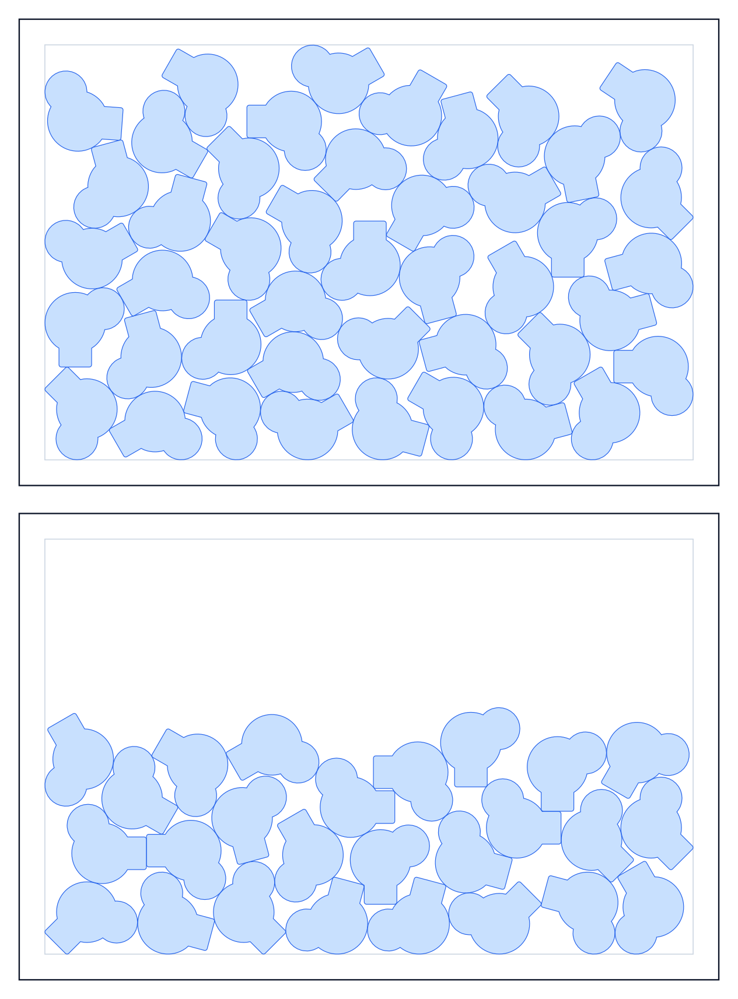

# Nesting Engine

A 2D irregular-shape nesting engine in C++20. It takes Bézier outlines and a
sheet size and returns placements that do not overlap, validated before they are
returned. It compiles to a static library and to a WebAssembly module, and the
WebAssembly module is what the web app consumes.

The engine has no dependency on any host application. It knows about points,
polygons, sheets and time budgets, and nothing else.



## Layout

| Path | What it is |
| --- | --- |
| `engine/include/nest/` | The public headers. `Nest.h` is the entry point. |
| `engine/src/geometry/` | Flattening, simplification, offsetting, clipping, transforms. |
| `engine/src/nfp/` | No-fit polygons: Minkowski sum, convex fast path, and a cache. |
| `engine/src/search/` | Bottom-left fill, a lattice fast path, guided search, refinement. |
| `engine/src/Validate.cpp` | The hard gate: no result is returned unvalidated. |
| `wasm/nest_wasm.cpp` | The JSON boundary and the three exported C functions. |
| `OUTLINE_NESTING_SPEC.md` | The algorithm specification. |

## How it works

Outlines come in as cubic Bézier paths and are flattened, unioned and offset by
half the requested gap, so that gap handling is geometric rather than a
post-hoc check. Overlap is decided with no-fit polygons built by Minkowski sum,
with a convex fast path and a cache keyed on the shape pair and rotation, since
the same pair is tested thousands of times.

Placement starts from bottom-left fill over a candidate ordering, with a lattice
fast path for the common case of one repeated shape on a grid. A guided search
then perturbs the ordering and rotations under a wall-clock budget, keeping the
best layout it has seen. Whatever it returns is checked by `validate()` for
pairwise penetration and sheet overrun; the report travels with the result.

The time budget is real. `timeBudgetSeconds` is what the search is allowed to
spend, and it will use it.

## Building

Needs CMake 3.28+, Ninja, and a C++20 compiler. Clipper2 and nlohmann/json are
fetched at configure time, so no vendoring and no package manager.

The static library:

```sh
cmake --preset release
cmake --build --preset release      # -> build/release/engine/libnest_engine.a
```

Presets: `debug`, `release`, `mac-universal-release` (arm64 + x86_64),
`win-x64-release`.

### The WebAssembly module

Needs [Emscripten](https://emscripten.org/docs/getting_started/downloads.html)
on `PATH`. This is the only build that does.

```sh
emcmake cmake --preset wasm
cmake --build --preset wasm         # -> build/wasm/wasm/nest-engine.{js,wasm}
```

`emcmake` is required — configuring the `wasm` preset with a plain `cmake` fails
with a message telling you so, rather than producing a native build that cannot
be loaded.

The output is an ES6 module (`MODULARIZE` + `EXPORT_ES6`) that works in a
browser, a worker or Node, with growable memory and an 8 MB stack. The stack is
not the default 64 KB on purpose: Douglas–Peucker recurses once per point it
keeps, and a 500-vertex outline from real artwork runs off the end of a small
stack as an unexplained "memory access out of bounds".

Commit the two output files into the web app. Nobody working on the web side
then needs a C++ toolchain; only rebuilding the engine does.

## The WebAssembly API

Three exported C functions:

```c
const char* nest_version(void);            // static, do not free
char*       nest_run(const char* reqJson); // caller frees with nest_free
void        nest_free(char* text);
```

`nest_run` never throws into the caller. A malformed request comes back as
`{"ok": false, "error": "..."}`.

```js
import factory from './nest-engine.js';

const M = await factory();
const ptr = M.ccall('nest_run', 'number', ['string'], [JSON.stringify(request)]);
const result = JSON.parse(M.UTF8ToString(ptr));
M.ccall('nest_free', null, ['number'], [ptr]);   // or it leaks
```

### Request

```jsonc
{
  "sheet": { "width": 200, "height": 300,
             "marginLeft": 5, "marginRight": 5,
             "marginTop": 5,  "marginBottom": 5 },
  "gap": 2,                    // mm between pieces
  "rotationStepDeg": 15,       // rotations the search may try
  "maxSheets": 1,
  "direction": "bottomLeft",   // topLeft | bottomRight | topRight
  "timeBudgetSeconds": 2.0,
  "seed": 1,
  "searchMaxVertices": 60,     // collision outlines are simplified to this
  "designs": [
    {
      "id": "rect40x30",
      "quantity": 12,
      "rotation": "zeroOr180", // free | fixed | zeroOr180
      "paths": [
        {
          "start": [0, 0],
          "closed": true,
          // each segment is six numbers: both control points, then the end point
          "segments": [[0,0,40,0,40,0], [40,0,40,30,40,30],
                       [40,30,0,30,0,30], [0,30,0,0,0,0]]
        }
      ]
    }
  ]
}
```

All lengths are millimetres. Only `sheet.width`, `sheet.height` and `designs`
are required; everything else has the default shown.

### Result

```jsonc
{
  "ok": true,
  "placements": [ { "designIndex": 0, "instanceIndex": 0, "sheetIndex": 0,
                    "x": 5.0, "y": 5.0, "rotationDeg": 0.0 } ],
  "unplaced": 0,
  "sheetCount": 1,
  "utilization": 0.2977,
  "designs":  [ /* per design: rings, vertices, areaMm2, searchVertices */ ],
  "validation": {
    "ok": true, "requested": 12, "placed": 12,
    "worstPenetrationMm": 0.0, "worstOverrunMm": 0.0,
    "violations": []
  }
  // plus diagnostics: generations, evaluations, threadsUsed,
  // nfpBuilt, nfpReused, elapsedSeconds, firstLayoutSeconds, fromLattice
}
```

Check `validation.ok`, not just `ok`. `ok` means the request was understood;
`validation.ok` means the layout it returned is actually legal. A result with
violations is still returned, so the caller can decide what to do, rather than
being silently dropped.

## Dependencies

| Library | Version | Licence |
| --- | --- | --- |
| [Clipper2](https://github.com/AngusJohnson/Clipper2) | 1.5.4 | Boost 1.0 |
| [nlohmann/json](https://github.com/nlohmann/json) | 3.11.3 | MIT |

nlohmann/json is fetched only for the WebAssembly build. The engine itself has
no serialisation in it.
